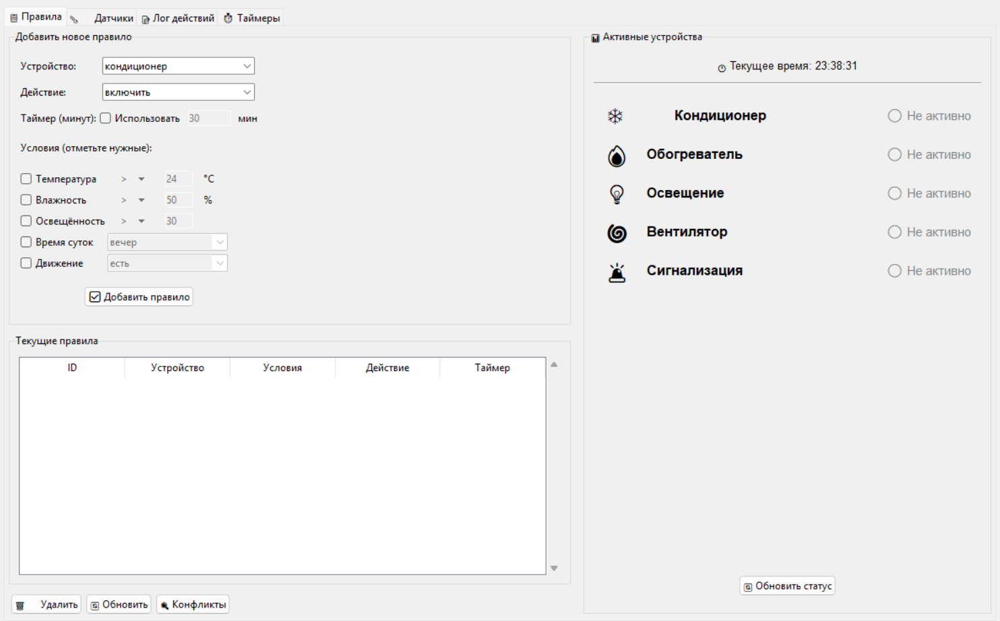
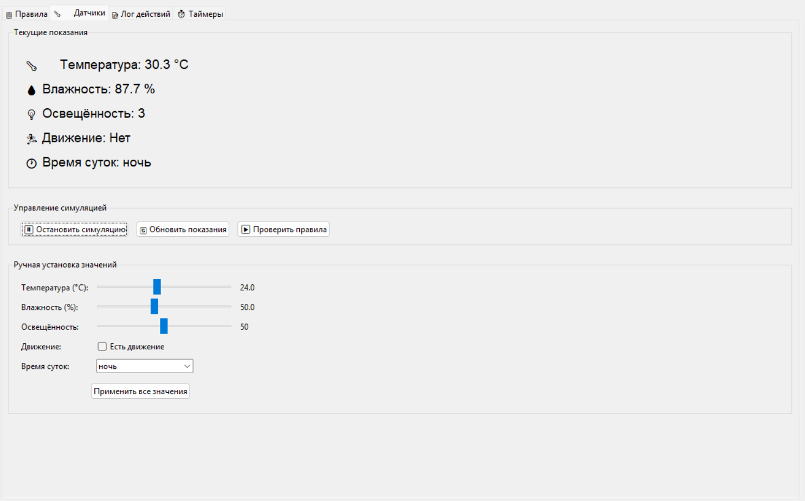
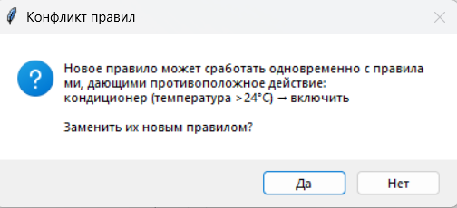
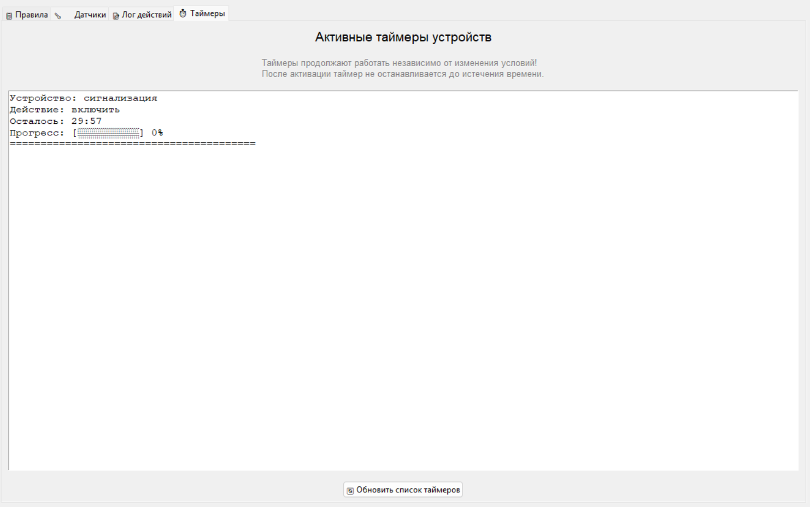
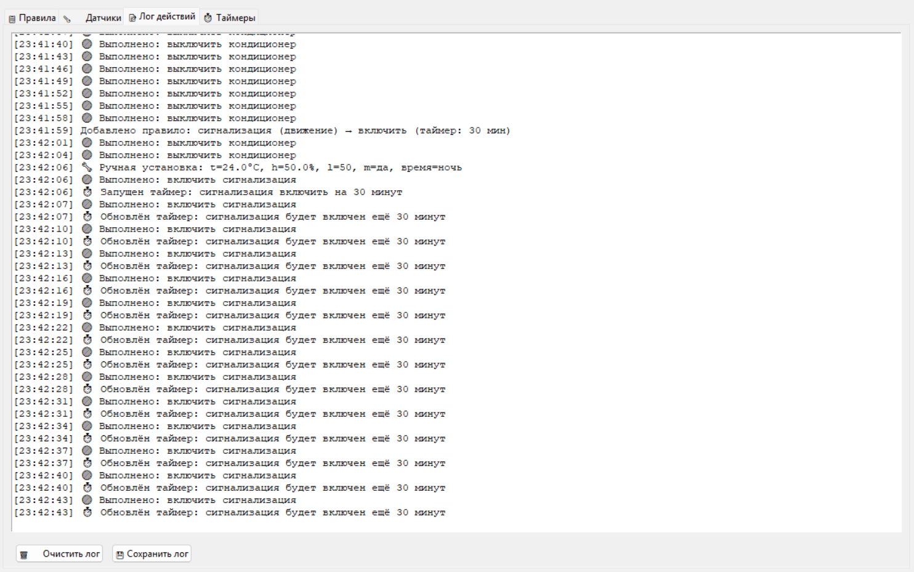

# Контроллер «Умный дом»

Многопоточное десктопное приложение на Python (Tkinter) для автоматизации бытовых
устройств по правилам. Датчики симулируются, правила задаются в интерфейсе,
а приложение само включает и выключает устройства и ведёт журнал действий.

## Возможности

- **Симуляция датчиков:** температура, влажность, освещённость, движение.
  Значения можно остановить и задать вручную, чтобы проверить правило.
- **Правила «если условия, то действие»** для устройств: кондиционер, обогреватель,
  освещение, вентилятор, сигнализация.
- **Условия на выбор:** температура, влажность, освещённость (операторы
  `>`, `>=`, `<`, `<=`, `=`), время суток (утро / день / вечер / ночь), движение.
- **Таймеры:** действие может выполняться заданное число минут.
- **Поиск конфликтующих правил:** приложение находит правила, которые могут
  одновременно дать противоположные команды одному устройству, и предлагает
  оставить нужное.
- **Журнал действий** в реальном времени.
- **Сохранение правил** в JSON-файл (`smart_home_rules.json`).

## Скриншоты

### Правила


### Датчики и симуляция


### Конфликт правил


<details>
<summary>Ещё скриншоты</summary>




</details>

## Как это устроено

```
main.py            интерфейс (Tkinter) и фоновая симуляция датчиков
rules_engine.py    логика правил: условия, срабатывание, поиск конфликтов
tests/             тесты логики правил (pytest)
```

- Симуляция датчиков и проверка таймеров работают в **отдельных потоках**, поэтому
  интерфейс не «замирает». Обновление интерфейса из потоков идёт через `root.after`,
  общие данные защищены `threading.Lock`.
- Логика правил **вынесена из интерфейса** в `rules_engine.py`, поэтому её можно
  тестировать без Tkinter.
- Как определяется конфликт: два правила конфликтуют, если они относятся к одному
  устройству, дают **разные действия**, и их условия **могут выполниться
  одновременно**. Для числовых условий (`>25` и `<30`) считается пересечение
  промежутков; правила с несовместимыми условиями (`>25` и `<20`, «день» и «ночь»)
  не конфликтуют.

## Запуск

Нужен Python 3.9+. Внешние библиотеки не требуются, только стандартная.

```bash
python main.py
```

## Тесты

```bash
pip install pytest
pytest
```

Тесты проверяют операторы условий, срабатывание правил (включая условие
«движения нет»), пересечение диапазонов и отсутствие ложных конфликтов.

## Планы

- Редактирование существующих правил.
- Подключение реальных или эмулированных устройств вместо симуляции.